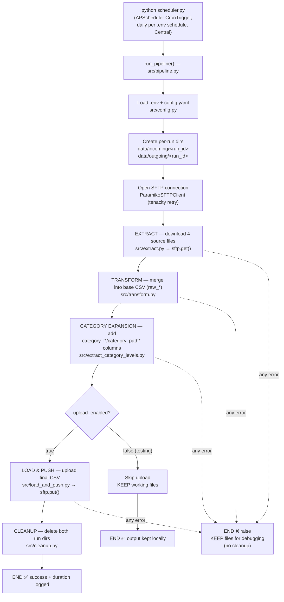
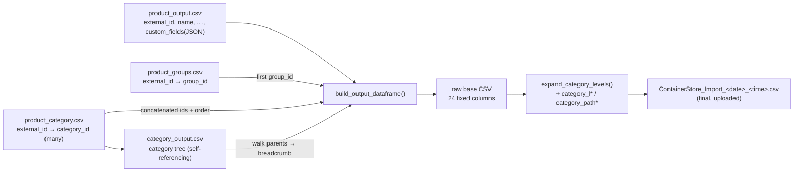

# Enrich AI ETL — Execution Flow

This document explains how the application runs end to end: the **entry points**
(where execution starts), **where every call goes**, and the **exit points**.
Diagrams are provided in both Mermaid (renders on GitHub) and ASCII (readable in
a terminal).

---

## 1. The entry point (START)

There is exactly one pipeline and exactly one process that triggers it.

| Start command | File | Mode | Ends when |
|---------------|------|------|-----------|
| `python scheduler.py` | `scheduler.py` | **Scheduler** — fires daily at the configured time | Never (runs until the container stops) |

It calls the core function **`run_pipeline()` in `src/pipeline.py`** on a cron
trigger. The ETL runs *only* at the scheduled time — there is no run-once mode.

---

## 2. High-level flow



ASCII version:

```
              python scheduler.py
         (fire daily per .env schedule, CT)
                          |
                          v
        ┌───────────────────────────────────────┐
        │   run_pipeline()  (src/pipeline.py)     │
        └───────────────────────────────────────┘
                          |
        1. load .env + config.yaml   (src/config.py)
        2. mkdir data/incoming/<run_id>, data/outgoing/<run_id>
        3. connect SFTP  (ParamikoSFTPClient, retry x3)
                          |
                          v
     ┌────────── EXTRACT (src/extract.py) ──────────┐
     │ sftp.get() x4  →  data/incoming/<run_id>/     │
     └───────────────────────────────────────────────┘
                          |
                          v
     ┌────────── TRANSFORM (src/transform.py) ──────┐
     │ read 4 CSVs → build 1 DataFrame → write CSV   │
     │        → data/outgoing/<run_id>/raw_*.csv     │
     └───────────────────────────────────────────────┘
                          |
                          v
     ┌──── CATEGORY EXPANSION (extract_category_levels)──┐
     │ add category_l*/category_path* columns            │
     │   raw_*.csv → data/outgoing/<run_id>/final.csv    │
     └───────────────────────────────────────────────────┘
                          |
                   upload_enabled?
                    /            \
                 yes              no  (testing)
                  |                |
                  v                v
   LOAD & PUSH (load_and_push)   skip upload,
   sftp.put() → remote upload_dir   keep files
                  |                |
                  v                |
   CLEANUP (src/cleanup.py)        |
   rmtree both run dirs            |
                  |                |
                  v                v
             END ✅ success    END ✅ (output kept)

   Any failure at extract/transform/expand/upload:
        → exception raised, NO cleanup, files kept for debugging  ❌
```

---

## 3. Detailed call chain (where every call goes)

Read this top-to-bottom. Indentation = "calls into".

```
scheduler.py : main()                       ← START
└─ src/config.py : load_env_file()          load .env into os.environ (python-dotenv)
└─ src/config.py : load_config()            parse config.yaml → AppConfig
│  └─ _resolve_env()                        expand ${ENV:VAR:-default} placeholders
│  └─ _as_int() / _as_bool()                coerce env strings safely
└─ src/config.py : configure_logging()      stdout (+ file only if ETL_LOGS_DIR set)
└─ BlockingScheduler + CronTrigger(hour, minute, timezone)   from config
└─ (waits…) each scheduled fire → _run_once(config)
└─ src/pipeline.py : run_pipeline(config)   ← CORE ORCHESTRATOR (called by _run_once)
   ├─ now = datetime.now(UTC)               one instant drives the stamps below
   ├─ make_run_id(now)                      "2025-08-27_12-15-37" (UTC, colon-free dir id)
   ├─ filename = ContainerStore_Import_<date>_<time>.csv
   │                                        (YYYYMMDD_HHMMSS in schedule tz / Central; colon-free — Windows-safe)
   ├─ build_sftp_factory(config)            returns a factory that builds a client
   ├─ incoming_dir.mkdir(exist_ok=False)    never reuse a run dir
   ├─ outgoing_dir.mkdir(exist_ok=False)
   ├─ with factory() as sftp:               src/sftp_client.py : ParamikoSFTPClient
   │  │  └─ _connect()                       paramiko.Transport + auth  (tenacity retry x3)
   │  │
   │  ├─ src/extract.py : download_sources(sftp, download_dir, source_files, incoming_dir)
   │  │     └─ loop 4 files → sftp.download() → paramiko sftp.get(remote, local)
   │  │
   │  ├─ src/transform.py : transform(...paths..., output_path=raw_output_path)
   │  │     ├─ read_sources()               4× pandas.read_csv (all strings, read-only)
   │  │     ├─ build_output_dataframe()
   │  │     │    ├─ build lookups: category tree, groups, categories-per-product
   │  │     │    ├─ per product: direct copies, groupings, category_ids,
   │  │     │    │               category_names (build_breadcrumb), C:* fields
   │  │     │    └─ (_parse_custom_fields for the JSON blob)
   │  │     └─ write_output()               pandas.to_csv (QUOTE_MINIMAL, \n) → raw_*.csv
   │  │
   │  ├─ src/extract_category_levels.py : expand_category_levels(raw_output_path, output_path)
   │  │     ├─ csv.DictReader(raw_*.csv)
   │  │     ├─ src/category_parsing.py : extract_paths / split_levels
   │  │     ├─ build_level_and_path_columns()  derive N levels, M paths
   │  │     └─ write final CSV (base cols + category_l1..N + category_path1..M)
   │  │
   │  └─ IF upload_enabled:
   │        src/load_and_push.py : upload_output(sftp, output_path, upload_dir)
   │           └─ sftp.upload() → paramiko sftp.put(local, remote)   (the FINAL csv)
   │        (connection closes here)
   │
   ├─ IF upload_enabled:
   │     src/cleanup.py : cleanup_run_directories(incoming_dir, outgoing_dir)
   │        └─ remove_directory() → shutil.rmtree()   (success only)
   │
   └─ return PipelineResult(run_id, output_path, remote_path, cleaned, duration_seconds)
└─ _run_once logs "Scheduled ETL run <id> succeeded"   ← END of this fire
   (a failed run is logged inside _run_once; the scheduler keeps running so the
    next scheduled fire still happens)
```

---

## 4. Start & end points at a glance

| Concern | Where |
|---------|-------|
| **START (scheduled)** | `scheduler.py::main` → `_run_once` |
| **Core orchestration** | `src/pipeline.py::run_pipeline` |
| **Remote START (download from)** | `sftp.download_dir` → default `/enrich/imports` |
| **Remote END (upload to)** | `sftp.upload_dir` → default `/EnrichAi/EnrichAi Imports` |
| **Local output written to** | `data/outgoing/<run_id>/ContainerStore_Import_<date>_<time>.csv` (final, expanded) |
| **Timezones** | schedule fires in **Central** (`ETL_SCHEDULE_TIMEZONE`); the output filename timestamp is stamped in that **same schedule tz**; the internal run-id dir is **UTC** |
| **END (success)** | after upload + cleanup; `PipelineResult` returned + logged; scheduler waits for the next fire |
| **END (test mode)** | after transform; upload+cleanup skipped, files kept; scheduler waits for the next fire |
| **END (failure)** | exception raised before cleanup; files kept; `_run_once` logs it and the scheduler keeps running |

---

## 5. Data flow (the 4 sources → 1 output)



Field mapping performed in `build_output_dataframe()`:

| Output column(s) | Source | Rule |
|------------------|--------|------|
| `external_id`, `name`, `description`, `url`, `image_url`, `brand`, `type` | product_output | direct copy |
| `groupings` | product_groups | first `group_id`, else blank |
| `category_ids` | product_category | all ids concatenated, no delimiter, file order |
| `category_names` | product_category + category_output | one `root > … > leaf` breadcrumb per category, quoted, comma-joined |
| `C:Product_ID`, `C:Height`, `C:Weight`, … (11 cols) | product_output.custom_fields (JSON) | value by key; fixed schema; missing = blank |
| `buckets`, `last_curation_update` | — | intentionally blank (client source undefined) |

---

## 6. Error handling & the cleanup rule

- Working directories are deleted **only after a successful upload**
  (`src/pipeline.py`, cleanup runs after the `try/except`).
- If **extract**, **transform**, **category expansion**, or **upload** raises, the
  exception propagates *before* cleanup → all local files are **kept** for
  debugging. `_run_once` in `scheduler.py` catches and logs it, and the scheduler
  keeps running so the next scheduled fire still happens.
- The SFTP connection retries **3×** with exponential backoff
  (`src/sftp_client.py`, tenacity) before giving up.
- The **remote source files are never modified** — extract only calls `get`.

---

## 7. Configuration flow (how settings reach the code)

```
.env  ──(python-dotenv: load_env_file)──▶  os.environ
config.yaml  ──(yaml.safe_load)──▶  raw dict
raw dict  ──(_resolve_env: ${ENV:VAR:-default})──▶  values
values  ──▶  AppConfig (frozen dataclass)  ──▶  run_pipeline
```

- Secrets/paths/schedule live in `.env`; `config.yaml` holds `${ENV:VAR}` placeholders with defaults.
- In Docker, `--env-file .env` populates `os.environ`; locally, `load_env_file()` reads `.env`.
- Environment variables always win over the YAML defaults.
